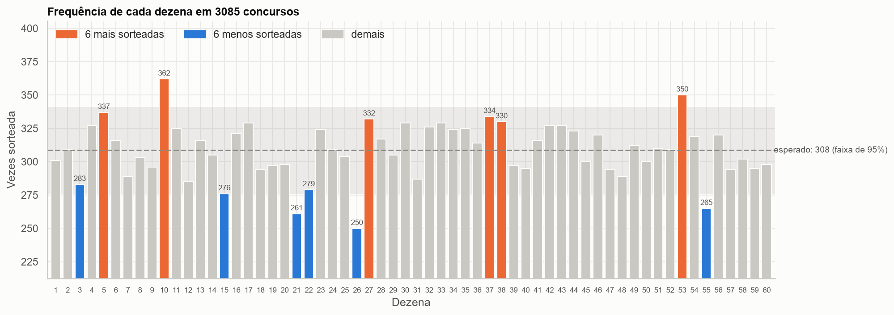
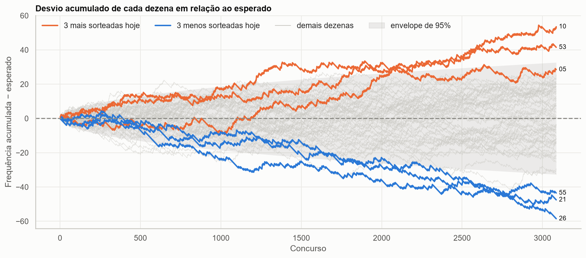
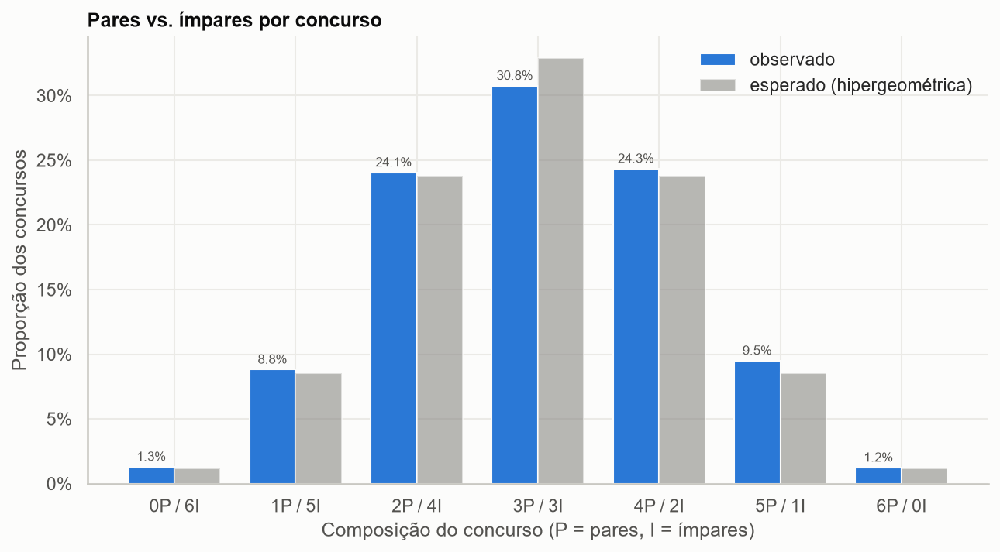
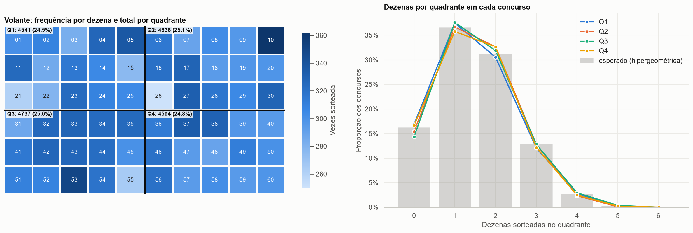
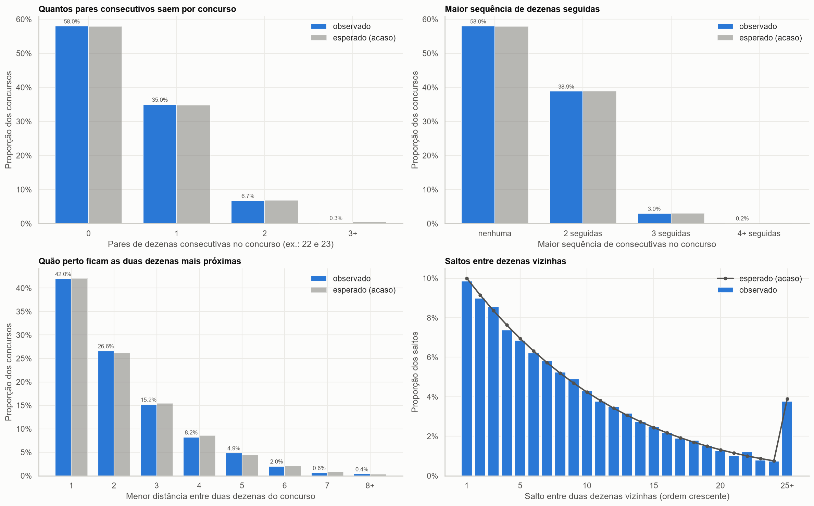
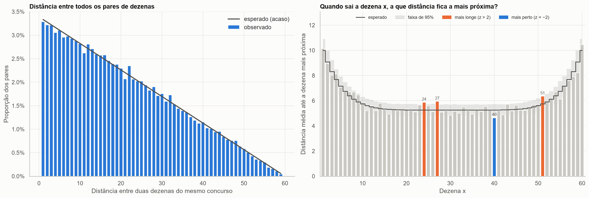
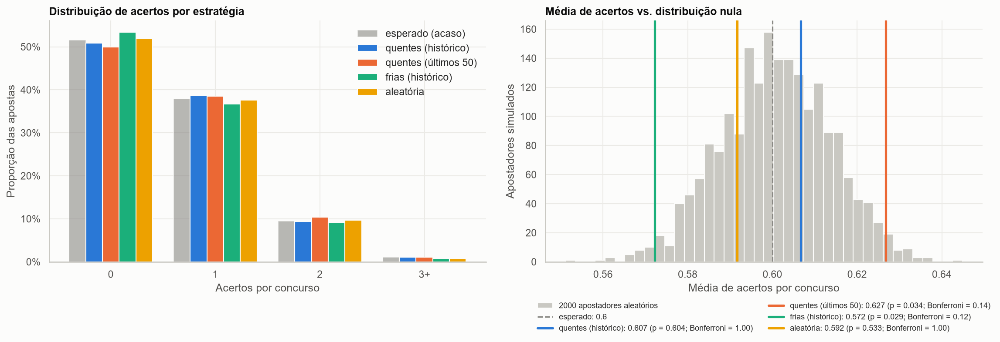

# Mega-Sena: dá para vencer o acaso?

<a target="_blank" href="https://cookiecutter-data-science.drivendata.org/">
    
</a>

Projeto de portfólio de Data Science sobre o histórico completo de sorteios da Mega-Sena.

O objetivo **não** é prever números. A Mega-Sena é um sorteio físico desenhado para ser
aleatório. A proposta é usar esse histórico para exercitar, de ponta a ponta, um pipeline de
dados com rigor estatístico:

1. **Engenharia de dados**: ETL incremental a partir da API pública da Caixa.
2. **Análise exploratória**: frequências, pares e ímpares, quadrantes do volante.
3. **Inferência**: testes de hipótese corretos para amostragem sem reposição.
4. **Experimentação**: backtest walk-forward que mostra que estratégias de "números quentes"
   ou "números atrasados" performam igual a um gerador pseudoaleatório.

A mesma análise roda também para Lotofácil, Quina, Lotomania, Timemania, Dia de Sorte, Dupla
Sena e +Milionária, resumidas na [comparação entre as loterias](#comparação-entre-as-loterias).

> 📓 **Análise completa, passo a passo:**
> [`notebooks/1.0-lsp-analise-mega-sena.ipynb`](notebooks/1.0-lsp-analise-mega-sena.ipynb)

## Principais resultados

> Esta seção é gerada automaticamente a partir dos resultados (`python -m mega_sena.pipeline`).

<!-- RESULTADOS:INICIO (gerado por mega_sena.report; não edite à mão) -->

Histórico analisado: **3.085 concursos**, de 11/03/1996 a 12/11/2026 (último concurso: 3085).

| Pergunta | Resultado | p-valor |
|---|---|---|
| As 60 dezenas saem com a mesma frequência? | **Não** | 0,005 (qui-quadrado corrigido); 0,007 (Monte Carlo) |
| A proporção de pares segue a teoria? | Sim | 0,186 |
| Os quadrantes recebem 25% cada? | Sim | 0,180 |
| Apostar nas "quentes" vence o acaso? | Não | 0,604 |
| Alguma das 4 estratégias vence o acaso (com Bonferroni)? | Não | menor p: 0,116 |



**A frequência das dezenas não é perfeitamente uniforme.** O teste global rejeita H0 (p = 0,005), e o teste de Monte Carlo, que não depende de aproximações, confirma (p = 0,007). A dezena 10 saiu 362 vezes e a 26 saiu 250, contra 308 esperadas.

| Período | Concursos | p-valor |
|---|---|---|
| 1996–2005 | 725 | 0,274 |
| 2006–2015 | 1.050 | 0,185 |
| 2016–2026 | 1.310 | < 0,001 |

Essa quebra é **exploratória**: as janelas foram escolhidas depois de ver o teste global, então os p-valores por período não são confirmatórios. O desvio se concentra em 2016–2026 (p < 0,001). Isso sugere hipóteses, como mudança de equipamento ou viés físico das bolas, mas não as confirma: com os dados disponíveis, não dá para separar um viés real de um evento raro do acaso.



O desvio acumulado mostra como cada dezena se afasta do esperado ao longo do tempo, com destaque para as 3 mais e as 3 menos sorteadas. O envelope cinza vale para uma dezena isolada: com 60 dezenas, é normal que algumas o ultrapassem.




A composição de pares e ímpares segue a hipergeométrica prevista pela teoria (p = 0,186), e os quadrantes recebem 25% das dezenas cada (p = 0,180).

### Distância entre as dezenas

Quão próximas saem as dezenas de um mesmo concurso? Números "colados", sequências e a dezena mais próxima de cada uma, comparados com as distribuições exatas de um sorteio aleatório.



- **42,0%** dos concursos tiveram ao menos um par de dezenas consecutivas (como 22 e 23), contra 42,1% esperados.
- **97** concursos tiveram 3 ou mais dezenas seguidas (esperado: 99), e **5** tiveram 4 ou mais (esperado: 5,2).
- A menor distância entre duas dezenas de um concurso é, em média, **2,18**, contra 2,18 esperada.

| Teste | p-valor | p (Bonferroni) |
|---|---|---|
| Pares consecutivos por concurso | 0,207 | 1,000 |
| Maior sequência de consecutivas por concurso | 0,997 | 1,000 |
| Menor distância por concurso | 0,827 | 1,000 |
| Saltos entre dezenas vizinhas (Monte Carlo) | 0,801 | 1,000 |
| Distância entre todos os pares (Monte Carlo) | 0,345 | 1,000 |
| Vizinha mais próxima de cada dezena (Monte Carlo) | 0,040 | 0,243 |

**Nenhuma medida de distância foge do acaso** depois da correção para múltiplas comparações. "Vizinha mais próxima de cada dezena (Monte Carlo)" tem p < 0,05 isoladamente, mas foram feitos 6 testes, e com Bonferroni o resultado deixa de ser significativo. No gráfico por dezena, 24, 27, 40 e 51 ficam fora da faixa de 95%; com 60 dezenas, espera-se que cerca de 3 fiquem fora por puro acaso.



À esquerda, distâncias curtas são mais comuns só porque existem mais pares assim no volante (há 59 pares a distância 1 e só 1 par a distância 59). À direita, as dezenas das pontas (01 e 60) têm a vizinha mais longe porque só têm vizinhas de um lado.

### Backtest



| Estratégia | Acertos por concurso | p (Monte Carlo) | p (Bonferroni) |
|---|---|---|---|
| *esperado ao acaso* | *0,600* | | |
| quentes (histórico) | 0,607 | 0,604 | 1,000 |
| quentes (últimos 50) | 0,627 | 0,034 | 0,136 |
| frias (histórico) | 0,572 | 0,029 | 0,116 |
| aleatória | 0,592 | 0,533 | 1,000 |

**Nenhuma estratégia se distingue do acaso** depois da correção para múltiplas comparações. "quentes (últimos 50)" e "frias (histórico)" parecem promissoras isoladamente (p < 0,05), mas foram testadas 4 estratégias: alguma sempre pode parecer boa por sorte, e com Bonferroni a vantagem some. Nenhuma estratégia acertou sequer uma quina em 2.985 apostas.

A lição: um teste estatisticamente significativo não implica um efeito explorável. O tamanho do efeito importa tanto quanto o p-valor.

<!-- RESULTADOS:FIM -->

## Comparação entre as loterias

As mesmas análises rodam para outras sete loterias da Caixa, cada uma com o volante, o número
de dezenas e os sorteios extras dela. A tabela reúne os p-valores de cada jogo; a pergunta é a
mesma em todas as colunas: o sorteio se comporta como aleatório?

<!-- COMPARACAO:INICIO (gerado por mega_sena.report; não edite à mão) -->

| Jogo | Regra | Concursos | Frequência | Pares/ímpares | Quadrantes | Distâncias¹ | Teste próprio² | Estratégias³ |
|---|---|---|---|---|---|---|---|---|
| Mega-Sena | 6 de 60 | 3.085 (desde 1996) | **0,005** | 0,186 | 0,180 | 0,243 | – | 0,116 |
| Lotofácil | 15 de 25 | 3.829 (desde 2003) | **< 0,001** | 0,895 | 0,056 | 0,127 | – | 0,070 |
| Quina | 5 de 80 | 7.167 (desde 1994) | **0,045** | 0,547 | 0,129 | 0,249 | – | 1,000 |
| Lotomania | 20 de 100, aposta 50 | 2.999 (desde 1999) | 0,386 | 0,841 | **0,037** | 0,174 | – | 1,000 |
| Timemania | 7 de 80, aposta 10 + Time do Coração | 2.467 (desde 2008) | 0,521 | 0,862 | 0,644 | 0,236 | 0,813 | 1,000 |
| Dia de Sorte | 7 de 31 + Mês da Sorte | 1.347 (desde 2018) | 0,333 | 0,750 | 0,813 | 0,891 | 0,579 | 0,312 |
| Dupla Sena | 6 de 50, 2 sorteios | 3.032 (desde 2001) | 0,284 | 0,567 | 0,755 | 1,000 | 0,391 | 0,192 |
| +Milionária | 6 de 50 + 2 de 6 trevos | 407 (desde 2022) | 0,102 | 0,173 | 0,399 | 0,098 | 0,902 / 0,955 | 0,192 |

¹ Menor p-valor entre os testes de distância do jogo, já corrigido por Bonferroni dentro do jogo. ² Mês da Sorte (Dia de Sorte), Time do Coração (Timemania, só até o concurso 1781, enquanto a lista de clubes foi fixa), trevos por trevo e por combinação (+Milionária) e dezenas em comum entre os dois sorteios (Dupla Sena). ³ Menor p-valor entre as estratégias do backtest, corrigido por Bonferroni. Em negrito, p < 0,05.

Ao todo são **108 testes** nos 8 jogos (sem contar os recortes por período, que são exploratórios). Se todos os sorteios fossem perfeitamente aleatórios, cerca de 5 dariam p < 0,05 só por acaso; deram **16**. Parte do excesso é o mesmo achado contado mais de uma vez: 3 deles são estratégias do backtest de jogos cuja frequência já deu significativa, e essas estratégias escolhem as dezenas justamente pela frequência. Olhados juntos, os 108 p-valores são compatíveis com a distribuição uniforme esperada sob H0 (Kolmogorov-Smirnov, p = 0,126; aproximado, porque testes do mesmo jogo usam os mesmos sorteios).

Com a correção de Bonferroni para os 108 testes (p < 0,0005), sobrevive só o teste de frequência das 25 dezenas da Lotofácil (p < 0,001). Mesmo assim, nenhuma estratégia de aposta da Lotofácil vence o acaso no backtest (menor p com Bonferroni: 0,070): o desvio é estatisticamente detectável, mas pequeno demais para ser explorado. Já o desvio de frequência da Mega-Sena (p = 0,005), destaque da seção anterior, não passa nessa régua: olhando 8 loterias, um p desse tamanho em algum lugar é esperado.

As figuras e tabelas de cada jogo ficam em `reports/figures/<jogo>` e `reports/<jogo>`.

<!-- COMPARACAO:FIM -->

## Metodologia

### 1. ETL ([`mega_sena/dataset.py`](mega_sena/dataset.py))

- **Fonte**: API pública do Portal de Loterias da Caixa
  (`servicebus2.caixa.gov.br/portaldeloterias/api/megasena/{concurso}`), que retorna um JSON
  por concurso. Como alternativa, `load_results_file()` lê a planilha oficial (CSV/XLSX)
  baixada manualmente do portal.
- **Extract**: o download é incremental e o arquivo bruto (`data/raw/megasena_api.jsonl`) só
  recebe novas linhas. Cada execução baixa só os concursos que faltam, com retry exponencial.
  A API bloqueia rajadas de requisições (HTTP 403), por isso o cliente usa pouco paralelismo e
  faz uma pausa entre as chamadas.
- **Transform**: datas convertidas para `datetime`, dezenas como inteiros, tanto em ordem
  crescente (`d1..d6`) quanto na ordem do sorteio (`bola1..bola6`). A validação checa
  concursos duplicados, dezenas fora de 1..60 e dezenas repetidas dentro de um concurso.
  `to_long()` pivota para o formato longo (uma linha por dezena sorteada).
- **Load**: `data/processed/megasena.csv`, um concurso por linha.

### 2. EDA ([`mega_sena/features.py`](mega_sena/features.py), [`mega_sena/plots.py`](mega_sena/plots.py))

Os **quadrantes** dividem o volante 6×10 em quatro blocos de 15 dezenas:

```
         col 1-5      col 6-10
        +-----------+-----------+
    1-3 |    Q1     |    Q2     |   Q1: 1-5, 11-15, 21-25     Q2: 6-10, 16-20, 26-30
        +-----------+-----------+
    4-6 |    Q3     |    Q4     |   Q3: 31-35, 41-45, 51-55   Q4: 36-40, 46-50, 56-60
        +-----------+-----------+
```

Toda figura traz a referência teórica em cinza, para o desvio observado ser comparado com o que
o acaso produziria, e não com uma expectativa intuitiva.

### 3. Testes de hipótese ([`mega_sena/hypothesis.py`](mega_sena/hypothesis.py))

**H0**: cada concurso é uma amostra uniforme de 6 dezenas distintas entre 60, independente dos
anteriores.

| Teste | O que verifica |
|---|---|
| Qui-quadrado das 60 frequências | Todas as dezenas saem com a mesma probabilidade (6/60) |
| Monte Carlo das 60 frequências | O mesmo, sem depender de aproximação assintótica |
| Qui-quadrado de pares por concurso | Contagem de pares segue a Hipergeométrica(60, 30, 6) |
| Qui-quadrado dos quadrantes | Cada quadrante recebe 25% das dezenas |
| Frequências por década (pós-hoc) | Onde no tempo está o desvio, se houver |

**Detalhe técnico.** O `scipy.stats.chisquare` supõe contagens multinomiais, ou seja, sorteio
*com* reposição. Como as 6 dezenas de um concurso são distintas, a variância real é menor pelo
fator de correção de população finita (60 − 6)/(60 − 1) = 54/59. Por isso a estatística é
dividida por esse fator. O teste [`test_corrected_chi2_is_calibrated_under_h0`](tests/test_hypothesis.py)
simula 400 históricos sob H0 e confirma que o teste corrigido rejeita cerca de 5% das vezes a
5% de significância.

### 4. Distância entre as dezenas ([`mega_sena/distances.py`](mega_sena/distances.py))

Mede quão próximas saem as dezenas de um mesmo concurso e compara com as distribuições
**exatas** de um sorteio uniforme, deduzidas por contagem de combinações (N = 60, K = 6):

| Medida | Distribuição sob H0 |
|---|---|
| Pares consecutivos por concurso | P(j) = C(K−1, j) · C(N−K+1, K−j) / C(N, K) |
| Maior sequência de consecutivas | programação dinâmica sobre o volante |
| Menor distância no concurso | P(menor ≥ g) = C(N − (g−1)(K−1), K) / C(N, K) |
| Salto entre dezenas vizinhas | P(g) = C(N − g, K − 1) / C(N, K) |
| Distância entre dois números quaisquer | P(d) = (N − d) / C(N, 2) |
| Vizinha mais próxima da dezena x | P(≥ d) = C(59 − m(d), 5) / C(59, 5), m(d) = dezenas a menos de d de x |

Cada fórmula é conferida contra 200 mil sorteios simulados nos testes automatizados. Medidas
com uma observação por concurso usam qui-quadrado; as que têm várias observações correlacionadas
por concurso (os 5 saltos, os 15 pares, as 6 vizinhas) usam p-valor de Monte Carlo. Como são 6
testes, os p-valores também são corrigidos por Bonferroni.

### 5. Backtest ([`mega_sena/modeling/backtest.py`](mega_sena/modeling/backtest.py))

Desenho **walk-forward**: para cada concurso *t*, cada estratégia aposta 6 dezenas olhando
**apenas** os concursos anteriores a *t*. Um teste garante que não há vazamento do futuro.

| Estratégia | Regra |
|---|---|
| quentes (histórico) | as 6 dezenas mais sorteadas até então |
| quentes (últimos 50) | as 6 mais sorteadas nos últimos 50 concursos |
| frias (histórico) | as 6 menos sorteadas ("estão atrasadas") |
| aleatória | gerador pseudoaleatório (`numpy.random.default_rng`) |

Sob H0, os acertos de **qualquer** aposta seguem a Hipergeométrica(60, 6, 6), com média exata de
0,6 por concurso, seja qual for o critério de escolha. Duas formas de testar:

- **Qui-quadrado** da distribuição de acertos (0, 1, 2, 3+) contra a hipergeométrica.
- **Monte Carlo**: 2.000 apostadores aleatórios nos mesmos concursos formam a distribuição nula
  da média de acertos; o p-valor bicaudal mostra onde cada estratégia cai.
- **Bonferroni**: como 4 estratégias são testadas ao mesmo tempo, o p-valor do Monte Carlo é
  multiplicado por 4. Sem isso, a chance de alguma estratégia parecer boa por sorte seria de
  cerca de 19%, e não 5%.

Empates de frequência são desfeitos ao acaso. Desempatar pela menor dezena enviesaria as
apostas para os números baixos.

## Como rodar

Requer Python 3.12 e [uv](https://docs.astral.sh/uv/).

```bash
uv sync                                   # cria o .venv e instala as dependências

# Atualização completa com os concursos mais recentes (dados, análises, figuras, README e notebook)
uv run python -m mega_sena.pipeline

# Ou cada etapa separadamente:
uv run python -m mega_sena.dataset        # ETL (download incremental)
uv run python -m mega_sena.features       # features por concurso
uv run python -m mega_sena.hypothesis     # testes de hipótese
uv run python -m mega_sena.distances      # distância entre as dezenas
uv run python -m mega_sena.modeling.backtest
uv run python -m mega_sena.plots          # figuras em reports/figures/<jogo>
uv run python -m mega_sena.report         # seção de resultados do README

uv run pytest                             # testes
```

Todos os comandos aceitam `--jogo <slug>` (padrão: `megasena`): `megasena`, `lotofacil`,
`quina`, `lotomania`, `timemania`, `diadesorte`, `duplasena` e `maismilionaria`; o pipeline
aceita também `--jogo todos`. As regras de cada loteria ficam em
[`games.py`](mega_sena/games.py). A seção de resultados e o notebook detalham a Mega-Sena; os
demais jogos geram as mesmas tabelas e figuras nas pastas de cada um, e a comparação entre as
loterias é reescrita a cada execução com os jogos que já têm resultados. Com `make` disponível (Linux/macOS/WSL), `make all` faz o
mesmo que o pipeline. Todos os passos usam semente fixa (`RANDOM_SEED` em
[`config.py`](mega_sena/config.py)) e são reprodutíveis.

## Organização

```
├── data
│   ├── raw            <- JSONs da API, um arquivo por jogo (append-only, fora do git)
│   └── processed      <- <jogo>.csv e <jogo>_features.csv (fora do git)
├── models/<jogo>      <- Resultados do backtest (resumo, acertos, distribuição nula)
├── notebooks          <- Notebook com a análise completa, já executado
├── reports
│   ├── figures/<jogo> <- Figuras da EDA e do backtest
│   └── <jogo>         <- Tabelas dos testes de hipótese e de distância
├── tests              <- Testes unitários e de calibração estatística
└── mega_sena
    ├── config.py      <- Pastas do projeto e semente aleatória
    ├── games.py       <- Regras de cada loteria (volante, sorteadas, aposta) e arquivos
    ├── dataset.py     <- ETL
    ├── features.py    <- Paridade, quadrantes, frequências
    ├── hypothesis.py  <- Testes qui-quadrado (com correção) e Monte Carlo
    ├── distances.py   <- Distância entre as dezenas: consecutivas, sequências, vizinhas
    ├── plots.py       <- Visualizações
    ├── report.py      <- Textos de resultados gerados a partir dos números (README e notebook)
    ├── pipeline.py    <- Atualização completa em um comando
    └── modeling
        └── backtest.py <- Estratégias e backtest walk-forward
```

Estrutura baseada no [Cookiecutter Data Science](https://cookiecutter-data-science.drivendata.org/).
